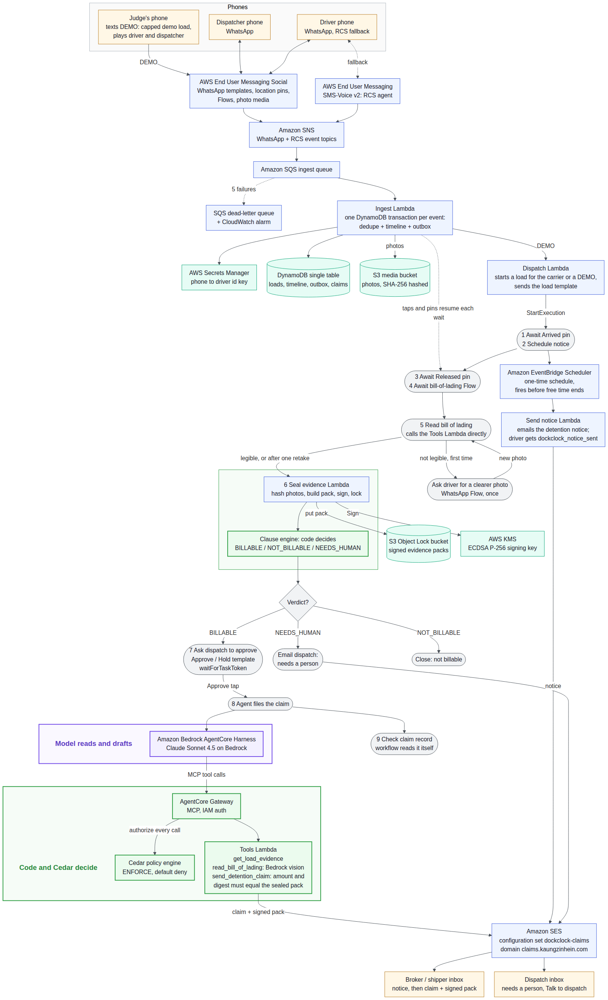

# DockClock

**DockClock gets small trucking fleets paid for the hours their drivers wait at the dock. The driver works in WhatsApp, the contract decides what is owed, and an AI agent files the claim once dispatch approves.**

> A driver who waits past free time is owed detention, and carriers get paid on only about half (55%) of the detention bills they send. Billing every stop over 2 hours doesn't fix that. On 24 test loads I labelled by hand, that rule asks for $2,554.18, and $1,314.18 of it (51%) wouldn't hold up: the contract denies it, pays less than was asked, or the carrier can't prove it. DockClock files the $1,245.00 those contracts owe, in 9 claims, and nothing they deny.
>
> I wrote the 24 loads and their right answers myself, from each contract's text. So this checks DockClock against the contracts, not against real payouts. Recompute it with `npm run scorecard` (fixtures frozen at sha256 `d45ae579…`).

## Try it in 3 minutes
- **In a browser, no login:** open https://d3djuoqhg6b8o2.cloudfront.net/judges and click Start. Seven short steps walk one recorded load. Five of them each take one reason a broker gives for not paying, and show the proof DockClock kept: the arrival and release pins, the notice email, a claim filed on time, a signature you can break yourself, and the contract's rules, where you change one fact and watch it decide again. The screens read the live system; a recorded copy stands in if the API is down.
- **On your phone, about 10 minutes:** send **DEMO** on WhatsApp to the number on our Devpost page. You play the driver and the dispatcher. The steps are under [Try it on WhatsApp](#try-it-on-whatsapp).
- **With the code, no AWS account needed:** `npm ci`, then `npm run scorecard` for the number above, and `npm run verify:pack -- docs/evidence/SMOKE-mve8yfv3.pack.json` to check a real sealed evidence pack.

## The problem
A truck can wait hours at a dock before it is loaded or unloaded. The contract for each load allows some waiting for free. That is the **free time**, usually 2 hours. After it, the shipper or broker owes the carrier **detention** pay by the hour. The rules sit in a detention clause in each load's contract (the rate confirmation), and every broker and shipper writes its own.

Most of this money is never collected:
- US truckload carriers are paid on only **55% of the detention invoices they send**.
- ATRI estimates **$5,103.95 of unpaid detention per truckload driver per year**.
- For a carrier with 40 truckload drivers, that is about **$204,000 a year**.

(ATRI, *Costs and Consequences of Truck Driver Detention*, 2024; survey estimates.)

Claims are usually refused for a reason the contract spells out. The carrier:
- did not send notice before detention started,
- filed after the claim window closed,
- had no signed **bill of lading** (the delivery paper the receiver signs, with the in and out times on it),
- arrived late for the appointment, or
- had no shipper confirmation.

Carriers also skip billing. They expect a refusal and don't want to upset the customer. In a 2023 survey by OOIDA, the owner-operators' association, 17% of members said they collect no detention pay at all ([survey](https://www.ooida.com/wp-content/uploads/2024/02/2023-Detention-Time-Survey-FINAL.pdf)).

The driver pays for the wait too. The US DOT Inspector General estimated that detention is linked to $1.1 to $1.3 billion a year in lost earnings for truckload drivers, and that 15 more minutes of average time at a facility raises the expected crash rate by 6.2% ([report ST2018019](https://www.oig.dot.gov/library-item/36237), 2018, from 2013 data). DockClock doesn't shorten the wait. It makes sure the wait the contract prices gets claimed, with proof.

## Who is in the story
| Role | Who | Real or fictional |
|---|---|---|
| **Loses the money** | A small trucking carrier and its driver, who sat at the dock unpaid | Fictional 40-truck US dry-van carrier |
| **Owes the money** | The broker or shipper, under the detention clause of the load's rate confirmation | Five fictional companies. Their clauses are modelled on published shipper and broker terms; each source and every assumed value is labelled in [`clauses.ts`](packages/clause-engine/src/clauses.ts) |
| **Buys DockClock** | A freight factoring company. Factors already buy carriers' invoices and are paid when the broker pays, so a provable detention claim is money they can advance on | Fictional. This is our target customer, not a signed one |

## How it works: one load, start to finish
1. **Dispatch.** The carrier sends the load to the driver on WhatsApp with an **Arrived** button, in English, Spanish or Québécois French.
2. **Arrival.** At the dock the driver taps Arrived and shares a location pin. WhatsApp stamps the pin with its own server time, and DockClock checks it against the facility's geofence (a boundary drawn around the site). The dock clock starts.
3. **Notice.** Before free time ends, DockClock emails the broker or shipper the detention notice the contract asks for, and tells the driver it went out.
4. **Release.** The driver taps **Released**, and the clock stops at that tap. A second pin, shared within 10 minutes, confirms it; a later pin sends the load to a person. A short WhatsApp form (a Flow) then asks for:
   - a photo of the signed bill of lading, taken with the camera (an old photo from the gallery can't be used);
   - the in and out times written on it;
   - whether the receiver signed it;
   - the reason for the wait.
5. **Verdict.** A clause engine, plain code with no AI model in it, checks the evidence against the contract. It answers `BILLABLE` with an amount, `NOT_BILLABLE` with the clause's reason, or `NEEDS_HUMAN` when the evidence disagrees. Times the form filled in and the driver left unchanged don't count as independent proof.
6. **Seal.** DockClock keeps its own copy of every photo and fingerprints it (a sha256 hash). The evidence and the verdict are signed with an AWS KMS key and stored so they can't be changed or deleted (S3 Object Lock). Anyone with the public key can check the pack later.
7. **Approval.** For a billable load, the dispatcher gets a WhatsApp message with **Approve claim** and **Hold**. Only the dispatcher's number can approve, and only once. Hold stops the claim. If nobody answers in two days, a person takes it over.
8. **Claim.** An AI agent on Amazon Bedrock AgentCore emails the claim to the broker or shipper through Amazon SES, with a one-page PDF summary and the signed pack attached. The PDF summary also goes back to dispatch on WhatsApp.

Drivers without WhatsApp get the same steps over RCS (rich messaging on Android phones). If a WhatsApp send fails, the load switches to RCS once.

### What the AI does, and what it can't do
The model is Claude on Amazon Bedrock. It does two jobs:
- **It reads the bill-of-lading photo.** The reading only raises or lowers our confidence in the evidence. It never sets a time or an amount.
- **It writes the opening sentence of the claim email.** The subject, the facts, the PDF and the attached pack all come from the sealed pack. The public key is linked, not attached.

The money is set by the clause engine and approved by a person. The agent can reach DockClock's tools only through an AgentCore Gateway. There, Cedar policies allow the claim tool only with an approval and an amount under a cap. The tool then refuses unless the amount and the pack's digest match the sealed values. So no prompt can change the money.

## What each AWS service does
| Service | Its job in DockClock |
|---|---|
| AWS End User Messaging Social | Sends and receives every WhatsApp message: templates, buttons, location requests, the Flow and photos |
| AWS End User Messaging SMS-Voice v2 | Runs the RCS agent for drivers without WhatsApp, and takes over when a WhatsApp send fails |
| Amazon SNS, Amazon SQS, AWS Lambda | Bring every inbound message and delivery event to DockClock's code, with retries and a dead-letter queue |
| Amazon DynamoDB | Holds each load, and records each event once, even when it arrives twice |
| AWS Step Functions | Runs one workflow per load, and waits for the driver's pins and form and the dispatcher's tap |
| Amazon EventBridge Scheduler | Fires the detention notice at the right moment before free time ends |
| Amazon SES | Emails the notice and the claim to the broker or shipper, and escalations to dispatch, and reports delivery |
| Amazon S3 with Object Lock | Keeps the photos, the signed packs and the sent emails where they can't be changed |
| AWS KMS | Signs each evidence pack; the public half of the key lets anyone check it |
| Amazon Bedrock | Runs Claude Sonnet 4.5, which reads the photo and drafts the claim email's opening line |
| Amazon Bedrock AgentCore | Runs the claims agent (Harness) and serves it DockClock's tools (Gateway), with Cedar policies deciding every tool call |
| Amazon CloudFront | Serves the judge console with no login, and a read-only API that shows only the demo workspace's loads |

Also used: AWS Secrets Manager (the key that turns a phone number into an opaque driver id), Amazon CloudWatch and AWS X-Ray (logs, alarms and traces), and AWS CDK (deploys it all as five stacks). Diagram and details: [`docs/architecture.md`](docs/architecture.md).



## What we'll tell you before you find it
Every line below is traced to a test, a file or a run in [`FACTS.md`](FACTS.md). Load ids say what kind of run it was:
- `LIVE-` loads were driven from a real phone.
- `SMOKE-` loads replay made-up driver messages through the deployed system. Everything after the phone (the workflow, the agent, SES, KMS) is real.

### Shown working on AWS
- **The whole loop from a real phone.** Load `LIVE-mvpoqheg` (2026-10-26, on the demo yard, which accepts any location) stayed 14 min 53 s at the dock. The notice email was delivered about 4 minutes before free time ended. The Released tap stopped the clock, and a second pin 14 seconds later confirmed it. The agent read the times off the photo of a fictional bill of lading (out 4:30 PM, 10 minutes after the tap, inside the 15-minute tolerance). The contract owed $9.88. The dispatcher tapped Approve on a real phone, and the agent's claim email went out 11.5 seconds later with the PDF summary, which also came back on WhatsApp. An earlier run on 10-23 (load `LIVE-mvlb0qzq`, $17.28) had a photo that could not be read, and DockClock marked it "not legible" instead of guessing.
- **It refuses on a real phone too.** On load `LIVE-mvlaajde` (2026-10-23) both pins were about 4.6 km outside the facility. The verdict was "needs a person", $0, and no claim went out.
- **The driver's side on a real phone:** dispatch, Arrived, location pin, Released, second pin, camera-only form, photo stored and hashed, pack signed (load `LIVE-mve0rrez`).
- **The money loop runs by itself after sealing.** The dispatcher got the approval message on a real phone and tapped **Approve claim**. The agent filed the claim by SES with the signed pack 14 seconds later, and the workflow checked the claim record before it reported success (load `SMOKE-mve8yfv3`; its driver messages were made up).
- **The detention notice.** EventBridge Scheduler fired before free time ended, SES emailed the broker or shipper, the delivery was recorded, and the sealed pack carries the notice, so clauses that require notice can pay (load `SMOKE-mveb2qnf`: SES reported delivery to our test mailbox 0.7 s after sending).
- **The agent says no when it should.** It refuses to file without an approval, and refuses a second filing for the same load (the claim is reserved before SES is called).
- **Reading the bill of lading:** 26 of 26 fields correct on 7 fictional test photos, and an honest "not legible" on a real blurry phone photo. The reading is part of the signed evidence.
- **RCS on a real phone:** dispatch card, Arrived, two location pins and a bill-of-lading photo, all over RCS (load `LIVE-mve1ve6d`, 2026-10-18 12:52–12:54 EDT). The switch from a failed WhatsApp send to RCS is tested and was run with made-up events.
- **The details that make it safe to run:** duplicate, out-of-order and stale taps are refused; STOP and START work; "Talk to dispatch" answers the driver and emails dispatch; a tampered pack fails verification. About 390 automated tests, plus about 80 for the console.

### Built and tested, not yet run live
- The request for a clearer photo when the first one is unreadable.
- The judges' DEMO path on WhatsApp, run from a judge's phone.

### Next, not on main
- Voice notes: a driver's spoken reason for the wait, transcribed by Amazon Transcribe into the load's timeline. Built with tests on a branch; not merged or deployed.

### Not built
- Replies to disputes: reading a broker's answer to a claim.

### Limits to know
- **The scorecard is our own labelling.** It measures the clause engine on 24 test loads whose right answers we wrote from each clause's text. It is a consistency check, not field data.
- **Every company is fictional.** The carrier, factor, brokers and shippers are made up. Claim and notice emails go to our own test mailbox.
- **A location pin can be faked.** The KMS signature proves the recorded messages, times and photo hash have not changed since sealing. It cannot prove where a phone really was, or that the paper itself is honest. That is why a load whose pins and paper times disagree goes to a person.
- **Judges can't try RCS on their own phones.** Our RCS agent is a Google testing agent that reaches only registered testers, so the console shows RCS from recorded runs.

## Try it on WhatsApp
Send **DEMO** on WhatsApp to the DockClock number given on the Devpost submission page (**DEMO ES** for Spanish, **DEMO FR** for Québécois French). It takes about 10 minutes, most of it the real wait (10 more if a photo has to be retaken). You are both the driver and the dispatcher:
1. Tap **Arrived** and share your location. In the demo any location counts; the pin is still recorded with WhatsApp's server timestamp.
2. Free time is 5 minutes. Wait longer than that. Shortly after you arrive, a detention notice is emailed, and the chat tells you.
3. Tap **Released**: the dock clock stops there. Share your location again within 10 minutes. On a piece of paper, write the arrival and release times the chat and the form show (US Eastern time in the demo), and photograph it in the form. Keep the times the form suggests.
4. The contract's verdict arrives in the chat. If it is billable, tap **Approve claim**. The agent files the claim, and the chat tells you the amount and the evidence pack's fingerprint.

**Change one thing** (send DEMO again to start over):
- **Leave early.** Tap Released before 5 minutes. The chat says "the wait stayed within free time". Nothing is claimed.
- **Change a time.** In the form, move the out time by more than 15 minutes. It no longer matches your Released tap, so the load is held for a person instead of claimed.
- **Share the pin late.** Wait more than 10 minutes after Released before sharing your location. The clock still stops at the tap, but the late pin can't confirm it, so the load is held for a person.
- **Send a blurry photo.** You are asked once for a clearer one; if none comes within 10 minutes, the first photo is used.

**What is real in the demo, and what isn't:**
- The contract is a demo contract (5 minutes free, $60 an hour, $30 cap, notice required before free time ends). It is fictional and not part of the scored set.
- The demo yard accepts any location, so the demo doesn't test the geofence.
- Claim and notice emails go to our own test mailbox, never to you.
- Each number gets 5 demos a day, reset at 00:00 UTC.
- We store your pins and photo with the demo load, as we would for a carrier. The signed pack records the times and the photo's hash, not your location. The public console shows your demo without your number, location or typed text.

## Check the evidence yourself
`npm run verify:pack -- docs/evidence/SMOKE-mve8yfv3.pack.json` checks a real sealed pack against the published KMS public key, with no AWS account, and shows a tampered copy failing. See [`docs/evidence/`](docs/evidence/README.md).

## How we use WhatsApp
| WhatsApp feature | Its job in DockClock |
|---|---|
| Utility template with buttons (`dockclock_load_dispatch`, 3 languages) | Starts the conversation for each load. Each button carries the load id and a one-time code, so a tap can't act on another load |
| Location requests | Arrival and release pins with WhatsApp's server time, checked against a geofence |
| A WhatsApp Flow with a camera-only photo picker | Captures the bill of lading so a saved photo can't stand in for a new one |
| Media download (`GetWhatsAppMessageMedia`) to S3 | Keeps our own copy of each photo, hashed and locked |
| Delivery and read receipts | Recorded against each send, as proof the driver got the message |
| Business-scoped user IDs (BSUID) | Keeps the driver matched to the load when WhatsApp sends a BSUID instead of a phone number |
| Opt-in record and STOP/START | No message without a recorded opt-in; STOP stops every message |
| Utility template `dockclock_notice_sent` | Tells the driver the detention notice was emailed and when free time ends |
| Utility template with Approve and Hold buttons (`dockclock_dispatch_approval`) | The dispatcher's one-tap decision. It releases the claim by resuming the load's waiting Step Functions workflow |
| Document message (`PostWhatsAppMessageMedia` from S3, then a `document` send) | Sends the one-page PDF claim summary back to dispatch once the claim is filed, inside the 24-hour window the Approve tap opened |

Per load, that is **3 utility templates (driver dispatch, notice sent, dispatcher approval) plus about 5 messages inside the free 24-hour window**, and 2 SES emails (the notice and the claim).

## Run it
```bash
npm ci
npm test            # about 390 tests (plus the console's own)
npm run scorecard   # recomputes the numbers at the top
```
`npm run scorecard` prints this summary, and CI checks it against the frozen fixtures:

> On 24 test loads, the contracts owe $1,245.00 in detention. DockClock would claim $1,245.00 of it (100%) in 9 claims, all 9 valid, and nothing a contract denies. The common "bill every stop over 2 hours" rule asks for $2,554.18, and $1,314.18 of that (51%) would not be paid: the contract denies it, pays less than was asked, or the carrier can't prove it.

Deploying to your own AWS account (CDK) needs an existing WhatsApp Business Account linked to AWS End User Messaging Social; see `.env.example`. `npm run deploy` uses your shell's AWS profile and region, not `.env`'s, so export `AWS_PROFILE` and `AWS_REGION` first.

## License
[MIT](LICENSE)
